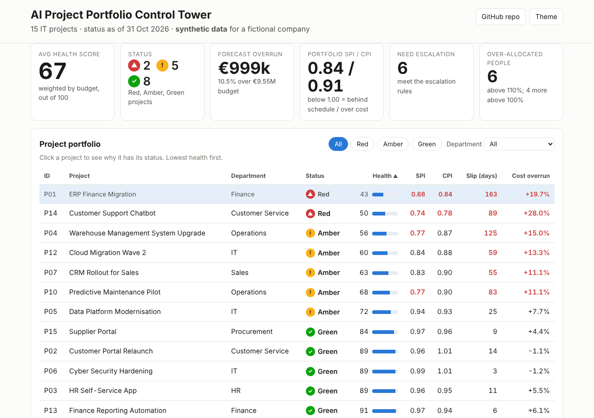
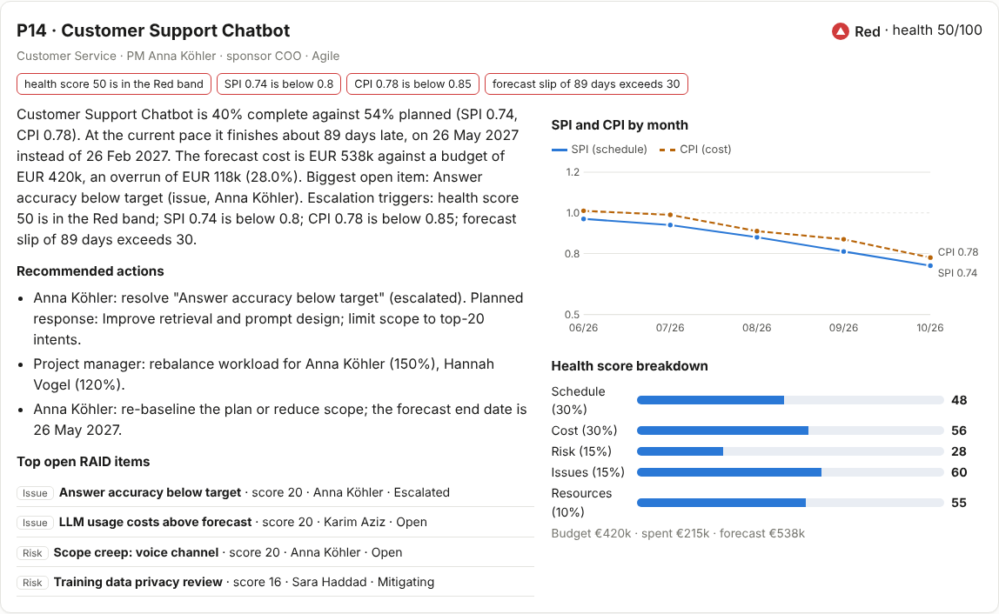
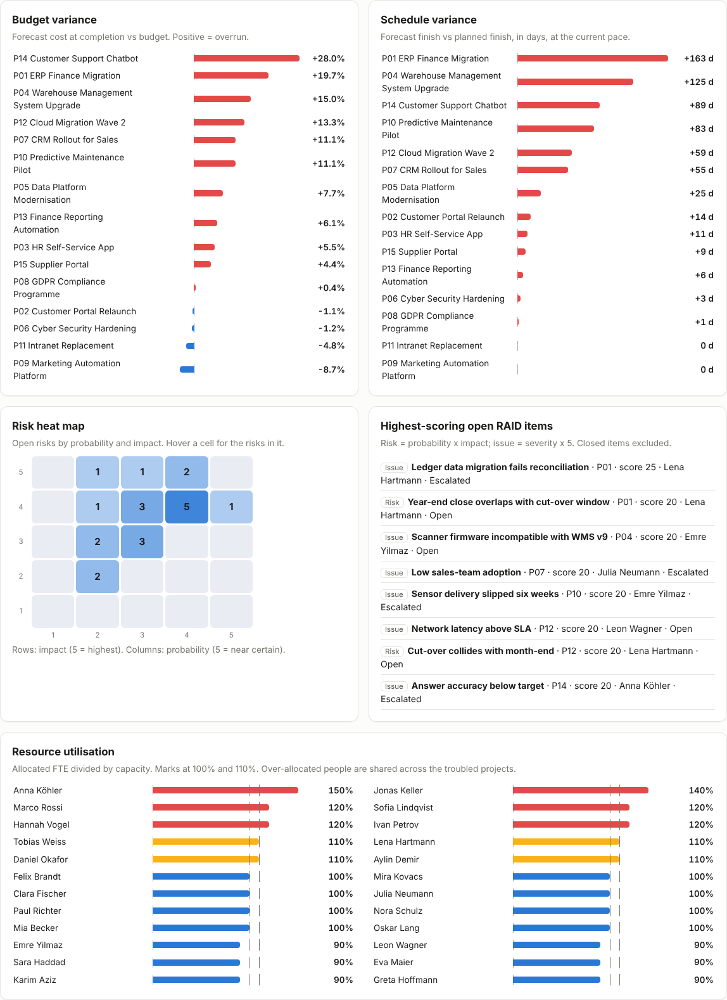

# AI Project Portfolio Control Tower

**An AI-powered dashboard that shows a company's 15 IT projects in one view, flags the ones that need escalation, and writes an executive status report explaining why.**

**Live dashboard:** `https://Mrunali121.github.io/ai-portfolio-control-tower/`



> **All data is synthetic** (fictional company "Meridian Works GmbH", made-up projects, people and numbers).
> The workflow and the method are real; the findings are not about any real organisation.

## The business problem
Management cannot easily see which projects are late, over budget, short of people or in need of escalation. Reports arrive in different formats and are compiled by hand.

## What it does
| Capability | How |
|---|---|
| Portfolio dashboard | Web dashboard (`index.html`) and a Power BI build kit (`powerbi/`) |
| Project health score (0-100) | Schedule 30% + cost 30% + risk 15% + issues 15% + resources 10%; Green 75+, Amber 55-74, Red below 55 |
| Budget variance | Forecast cost at completion (budget / CPI) vs budget |
| Schedule variance | Forecast finish at the current pace vs plan (days) |
| Risk and issue analysis | 45-entry RAID register, heat map, highest-scoring open items |
| Resource utilisation | Allocation / capacity per person; over 100% stretched, over 110% over-allocated |
| Escalation rules | Red health, SPI < 0.80, CPI < 0.85, slip > 30 days, or an open critical issue; reasons are shown |
| AI executive report | An LLM writes the narrative from calculated facts; every figure is then verified against those facts |
| AI recommendations | Per project, with named owners taken from the RAID register |

## What the sample portfolio shows
Status as of 31 Oct 2026: budget EUR 9.55M, forecast EUR 10.55M (about EUR 1.0M or 10.5% over). Two projects are Red, five Amber, eight Green, and six meet the escalation rules. The worst is **P01 ERP Finance Migration** (health 43, SPI 0.68, 163 days late). Over-allocated specialists, such as one database administrator at 140% across four projects, link the delays.

Read the full report: [`reports/executive-status-report-2026-10.md`](reports/executive-status-report-2026-10.md)

| Project drill-down | Variance, risk and resources |
|---|---|
|  |  |

## Architecture
```
data/portfolio_dataset.xlsx  (Excel: Projects, RAID, Resources, Allocations, Monthly_Progress)
        │   src/generate_data.py                 (synthetic, seeded)
        ▼
data/csv/*.csv ──► src/metrics.py ──► SPI, CPI, forecasts, health score, escalation, utilisation
                         │
                         ├─► data/processed/*.csv ──► Power BI (powerbi/)
                         ├─► data.js ──► index.html  (web dashboard, GitHub Pages)
                         ├─► app/streamlit_app.py    (interactive app)
                         └─► outputs/portfolio_facts.json
                                   │
                                   ▼
                  src/report_generator.py ── LLM (Anthropic / OpenAI / offline writer)
                                   │
                                   ▼
                  verify_numbers() ──► reports/*.md
```
**Design principle:** code calculates, the LLM only writes, and a checker confirms the writing contains no figure that is not in the data.

## Repository contents (the 10 deliverables)
| # | Deliverable | Where |
|---|---|---|
| 1 | Project Charter | [`docs/01-project-charter.md`](docs/01-project-charter.md) |
| 2 | Business Case | [`docs/02-business-case.md`](docs/02-business-case.md) |
| 3 | Requirements Specification | [`docs/03-requirements-specification.md`](docs/03-requirements-specification.md) |
| 4 | Project Plan | [`docs/04-project-plan.md`](docs/04-project-plan.md) |
| 5 | Synthetic Portfolio Dataset | [`data/portfolio_dataset.xlsx`](data/portfolio_dataset.xlsx), [`data/csv/`](data/csv), [`docs/data-dictionary.md`](docs/data-dictionary.md) |
| 6 | Dashboard screenshots and file | [`screenshots/`](screenshots) and `index.html` (web); [`powerbi/`](powerbi) (Power BI build kit, see note below) |
| 7 | Python integration code | [`src/`](src), [`app/`](app), [`tests/`](tests) |
| 8 | AI-generated Project Status Report | [`reports/executive-status-report-2026-10.md`](reports/executive-status-report-2026-10.md) |
| 9 | Risk and Issue Register | [`docs/risk-issue-register.md`](docs/risk-issue-register.md), [`docs/portfolio-raid-register.md`](docs/portfolio-raid-register.md) |
| 10 | Lessons Learned | [`docs/lessons-learned.md`](docs/lessons-learned.md) |

**Power BI note:** a `.pbix` can only be saved from Power BI Desktop. [`powerbi/`](powerbi) contains the loading queries, data model, every DAX measure, a theme and page layouts to rebuild it in about 45 minutes; the web dashboard shows the same KPIs and charts.

## Run it
```bash
pip install -r requirements.txt
python src/generate_data.py                 # regenerate the dataset (optional, already in the repo)
python src/run_pipeline.py --provider offline   # metrics, facts, report, dashboard data
python -m unittest discover -s tests -v     # 13 tests
streamlit run app/streamlit_app.py          # interactive app
```
Open `index.html` in a browser for the web dashboard (no server needed).

**Generate the report with a real LLM:** copy `.env.example` to `.env`, add `ANTHROPIC_API_KEY` (or `OPENAI_API_KEY` and `OPENAI_MODEL`), then run `python src/run_pipeline.py --provider anthropic` (or `openai`). The pipeline prints whether all figures were traceable.

## Limitations
- Synthetic data; thresholds and weights are reasonable defaults, not validated on real projects.
- Forecasts use simple earned-value extrapolation; they do not model risk events.
- The Streamlit app and the live LLM calls were not run end to end in the build environment (the provider code is unit-tested with a fake HTTP layer). Run them locally and open an issue if something breaks.
- No live integration with Jira, MS Project or SAP.

## Skills demonstrated
Portfolio and programme management, earned value, RAID management, stakeholder reporting, business case and requirements writing, Python and pandas, data modelling, Power BI and DAX, LLM prompting with guardrails, testing, accessible dashboard design.

## License
MIT
