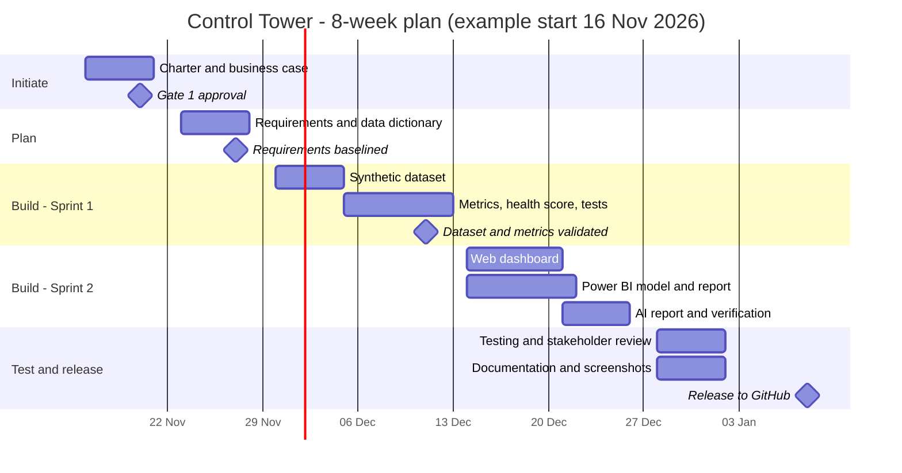

# Project Plan - AI Project Portfolio Control Tower

Eight weeks, hybrid delivery: stage gates for approval, two-week sprints for build. Week 1 starts on your real start date; the Gantt below uses 16 Nov 2026 as an example start.

## 1. Work breakdown structure
| WBS | Work package | Output |
|---|---|---|
| 1 | Initiation | Charter, business case, stakeholder list |
| 2 | Requirements | Requirements specification, data dictionary |
| 3 | Data | Synthetic dataset (Excel/CSV), data checks |
| 4 | Analytics | Metrics, health score, escalation rules, unit tests |
| 5 | AI report | Prompt, report generator, number verification, sample report |
| 6 | Dashboards | Web dashboard, Power BI model and report, Streamlit app |
| 7 | Quality | Test plan, defect fixes, accessibility check, stakeholder review |
| 8 | Release | README, screenshots, GitHub publication, handover, lessons learned |

## 2. Schedule

## 3. Sprint plan
| Sprint | Goal | Key items |
|---|---|---|
| 1 (weeks 3-4) | Trustworthy numbers | Dataset, earned-value metrics, health score, escalation rules, RAID scoring, unit tests |
| 2 (weeks 5-6) | See and read it | Dashboard, Power BI pages, per-project summaries, recommendations |
| 3 (weeks 7-8) | Prove it and ship | LLM report with number check, Streamlit app, test and review, documentation, release |

## 4. Roles and responsibilities (RACI)
R = responsible, A = accountable, C = consulted, I = informed.
| Activity | Sponsor | PM | PMO analyst | BI dev | Data engineer | PMO head |
|---|---|---|---|---|---|---|
| Charter and business case | A | R | C | I | I | C |
| Requirements | I | A | R | C | C | C |
| Dataset and metrics | I | A | C | I | R | C |
| Dashboard and Power BI | I | A | C | R | C | C |
| AI report | I | A | C | I | R | C |
| Acceptance | A | R | C | C | C | R |

## 5. Budget by phase (EUR 58,900 total)
| Phase | EUR |
|---|---|
| Initiation and requirements | 9,200 |
| Data and analytics | 17,400 |
| Dashboards | 18,000 |
| AI report | 7,300 |
| Test, release, handover | 7,000 |
| **Total** | **58,900** |

## 6. Communication plan
| What | Who | How often |
|---|---|---|
| Sprint review and demo | Sponsor, PMO head | End of each sprint |
| Status report (RAG, risks) | Sponsor | Weekly, one page |
| Stand-up | Team | Three times a week, 15 minutes |
| Steering committee | CIO, PMO head, Finance | At gates 1, 3 and 4 |

## 7. Quality plan
Automated tests (`tests/`), number verification of AI text, browser check at phone and desktop width, accessibility checks (keyboard, contrast, no colour-only status), peer review of metric formulas by the PMO head.

## 8. Change control
Requests go to the PM, are logged with impact on scope, time and budget, and are approved by the sponsor above EUR 2,000 or two days of effort. Live integrations (Jira, SAP) were requested during initiation and deferred to a later release.

## 9. Definition of done
Code reviewed, tests green, figures traceable, documentation updated, screenshots refreshed, acceptance criteria AC-1 to AC-5 passed.
